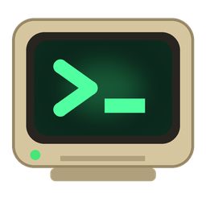

# Super Star Trek для Windows

Порт классической текстовой игры **Super Star Trek** (C, 1978 → порт на C Криса Нистрома, 1996) на Windows 10 с сохранением текстового режима. Игра работает в зелёном терминале 24×80 на экране ретро-монитора, со звуками, русским интерфейсом, справкой по F1 и сохранениями.



## Возможности

- Терминал 24×80 поверх изображения монитора, зелёный шрифт Consolas, прокрутка вверх.
- Русская локализация игры (UTF-8).
- Звук: стартовая мелодия, затем фоновый цикл; щелчок при каждом нажатии клавиши (Shift, Ctrl, Alt — один раз при нажатии, без повтора при удержании).
- Справка по **F1** в отдельном окне (Markdown → RichEdit).
- Сохранения командой `sav` в `saves.json` рядом с exe, по имени капитана (до 10 символов).
- Всё встроено в exe (картинка, звуки, справка, иконка); внешние библиотеки не нужны.

## Управление

| Действие | Клавиши |
|---|---|
| Ввод команды | символы + **Enter**, **Backspace** |
| Справка | **F1** (повторное нажатие закрывает) |

Команды игры: `nav`, `srs`, `lrs`, `pha`, `tor`, `she`, `dam`, `com`, `sav`, `xxx`. Подробности — в [справке](StarTrek/Files/startrek_ru.md).

### Сохранения

- Перед миссией игра спрашивает имя капитана; если для него есть сохранение, предлагает его загрузить.
- `sav` работает только в квадранте без клингонов.
- Формат — JSON, массив контейнеров `{"Commander": "...", "version": 1, "state": {...}}`; повторное сохранение под тем же именем перезаписывает контейнер. Запись атомарная (`.tmp` + замена), при загрузке данные проверяются по типам, диапазонам и согласованности.

## Сборка

### Visual Studio 2022

1. Открыть `StarTrek.sln`.
2. Конфигурация **Release | x64**, `Ctrl+Shift+B`.
3. Готовый `StarTrek.exe` — в `bin\x64\Release\`.

Требуется компонент «Разработка классических приложений на C++». Опция `/utf-8` уже прописана в проекте; без неё `startrek_port.h` остановит сборку с ошибкой.

### MinGW-w64 (не проверялось)

Из папки `StarTrek`:

```
windres resource.rc -O coff -o resource.o
gcc -O2 -c startrek_ru.c -o startrek.o
gcc -O2 -c startrek_save.c -o startrek_save.o
g++ -O2 -municode main.cpp startrek.o startrek_save.o resource.o -o StarTrek.exe -mwindows -lgdiplus -lgdi32 -lole32 -lshell32 -lwinmm
```

## Устройство

```
StarTrek/
  main.cpp          окно, терминал, звук, поток игры, справка (Win32 + GDI+)
  startrek_ru.c     игра (логика оригинала, русские тексты)
  startrek_port.h   макросы: printf/gets/getchar/fopen/exit/main -> функции терминала
  startrek_save.c   имя капитана, saves.json (JSON-парсер, проверки), команда sav
  resource.rc       ресурсы exe
  Files/            monitor.png, *.wav, app.ico, startrek_ru.md (справка)
```

- Игра запускается в отдельном потоке и использует блокирующий ввод/вывод; `main.cpp` подменяет их через `term_*` (потокобезопасно).
- Игра компилируется как C, окно — как C++; точка входа игры переименована в `startrek_main`.
- Ресурсы (`MONITOR_PNG`, `START_WAV`, `LOOP_WAV`, `KLIC_WAV`, `STARTREK_MD`, иконка `1`) загружаются из exe; щелчок играется через пул `waveOut`, чтобы не прерывать фоновый цикл.

## Авторство и лицензия

- Оригинал: Super Star Trek, Mike Mayfield (1971), Bob Leedom (1974), Dave Ahl (*BASIC Computer Games*, 1978).
- Порт на C: © 1996 Chris Nystrom — распространяется как свободное ПО «без каких-либо гарантий»; текст в заголовке `startrek_ru.c`.
- Русская локализация, оболочка для Windows, сохранения: Иванов Виктор.

Лицензия на оболочку (`main.cpp`, `startrek_save.c`, `startrek_port.h`) и на графику/звуки пока не выбрана — добавьте файл `LICENSE` перед публикацией.
